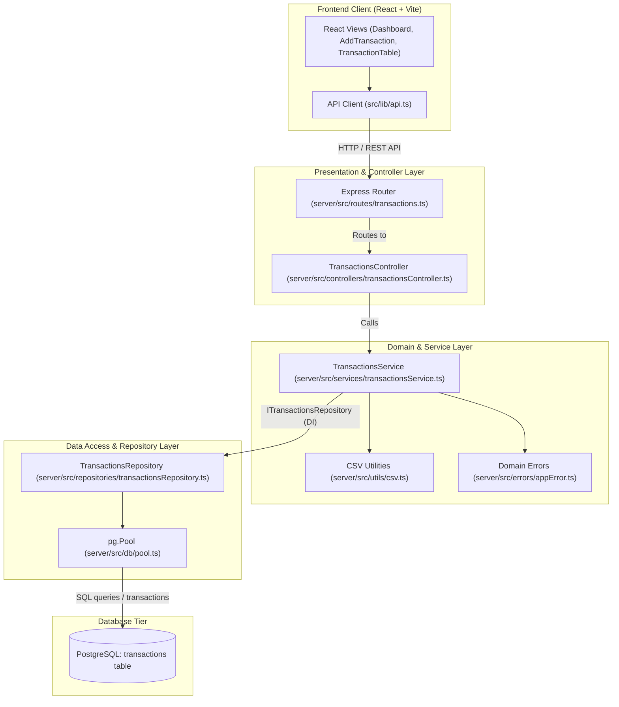

# Layered Architecture ("After" State)

This document describes the refactored layered architecture introduced in Assignment 02, beginning with the Transactions subsystem (Commit 3).

---

## 1. Architectural Overview

The backend has transitioned from a monolithic "route-to-database" script model to an enterprise-grade **Controller-Service-Repository** pattern.

### Separation of Responsibilities

1. **Routes (`routes/transactions.ts`)**:
   - Thin route definition and middleware attachment (`requireAuth`).
   - Delegates all HTTP request handling directly to controller methods.
   - Zero SQL, zero `pool` imports, zero business logic.

2. **Controllers (`controllers/transactionsController.ts`)**:
   - HTTP transport adapter: reads `req.params`, `req.body`, and `req.session`.
   - Delegates domain operations to `TransactionsService`.
   - Maps domain exceptions (`ValidationError` -> 400, `NotFoundError` -> 404) to standard HTTP status codes and JSON payloads.
   - Zero SQL and zero database pool coupling.

3. **Services (`services/transactionsService.ts`)**:
   - Pure business logic layer: input validation, sanitization, data conversions, CSV parsing/generation, and domain calculations.
   - Completely decoupled from HTTP frameworks (does not import `express`) and database drivers (does not import `pg` or `pool`).
   - Repository dependency is injected via constructor interface (`ITransactionsRepository`), enabling rapid and deterministic unit testing with in-memory test doubles.

4. **Repositories (`repositories/transactionsRepository.ts`)**:
   - Encapsulates all data access and SQL persistence.
   - Provides clean, strongly-typed methods returning plain TypeScript objects (`findAllByUser`, `insert`, `update`, `deleteById`, `bulkInsert`).
   - Manages connection checkouts and transactional integrity (`BEGIN`, `COMMIT`, `ROLLBACK`) during bulk operations.

5. **Database**:
   - PostgreSQL relational database tables (`transactions`, `users`, etc.).

---

## 2. Architecture Diagram (Mermaid)

---

## 3. Concrete Code-Quality Improvements

### 1. Isolated, Fast Unit Testing Without Database Overhead
- **Before**: Testing transaction creation, validation, or CSV import/export required booting a live PostgreSQL database and running heavy integration tests that took 20–30 seconds.
- **After**: `TransactionsService` accepts `ITransactionsRepository` via constructor dependency injection. A lightweight `FakeTransactionsRepository` tests all business logic (validation, missing fields, negative amounts, CSV row errors, and defaults) in **31 milliseconds** without any database dependency.

### 2. Elimination of Direct Database Coupling in HTTP Handlers
- **Before**: `server/src/routes/transactions.ts` directly imported `{ pool }` and executed 9 raw SQL queries, including manual connection checkouts and `BEGIN/COMMIT/ROLLBACK` blocks.
- **After**: The router file is now 14 lines long with zero SQL and zero database references. All database interactions are quarantined within `TransactionsRepository`.

### 3. Unified Validation and Reduced Cyclomatic Complexity
- **Before**: Input validation was fragmented. CSV import had its own ad-hoc row validator with cyclomatic complexity 11, and `POST /` and `PUT /:id` duplicated condition checks with complexity 9.
- **After**: Centralized validation in `TransactionsService` eliminates duplication, enforces strict type guards, and reduces function complexity below the allowed linting threshold of 8.
