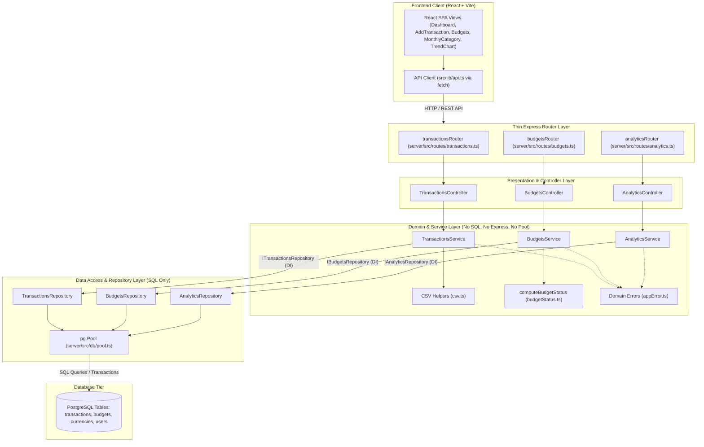

# Layered Architecture ("After" State)

This document describes the refactored layered architecture introduced in Assignment 02 for **Transactions**, **Budgets**, and **Analytics / Monthly Budget Summary**.

---

## 1. Architectural Overview

The backend has transitioned from a monolithic "route-to-database" script model to an enterprise-grade **Controller -> Service -> Repository -> Database** pattern across all core financial features.

### Layer Separation of Responsibilities

1. **Routes (`routes/transactions.ts`, `routes/budgets.ts`, `routes/analytics.ts`)**:
   - Extremely thin routing layers.
   - Enforce authentication via `requireAuth` middleware.
   - Directly wire HTTP endpoints to controller methods.
   - **Zero SQL, zero `pool` imports, and zero domain logic**.

2. **Controllers (`controllers/transactionsController.ts`, `budgetsController.ts`, `analyticsController.ts`)**:
   - HTTP transport adapters: extract `req.params`, `req.query`, `req.body`, and `req.session`.
   - Call appropriate service methods.
   - Map domain errors (`ValidationError` -> 400, `NotFoundError` -> 404) to HTTP responses.
   - **Zero SQL and zero database pool coupling**.

3. **Services (`services/transactionsService.ts`, `budgetsService.ts`, `analyticsService.ts`)**:
   - Pure domain business logic:
     - Transaction validation, amount checks (`amount > 0`), and type guards (`"Income" | "Expense"`).
     - CSV parsing, row error collection, and CSV export formatting.
     - Budget period calculations, threshold tracking (`ok`, `warning`, `exceeded`), and percentage usage.
     - Analytics month clamping (1–24 months) and trend assembly.
   - Decoupled from HTTP (`express`) and persistence (`pg.Pool`).
   - All repositories are injected via constructor interfaces (`ITransactionsRepository`, `IBudgetsRepository`, `IAnalyticsRepository`), enabling fast in-memory unit tests with mock/fake repositories.

4. **Repositories (`repositories/transactionsRepository.ts`, `budgetsRepository.ts`, `analyticsRepository.ts`)**:
   - Encapsulate all SQL persistence and data querying.
   - Return plain, strongly-typed domain records.
   - Contain zero domain rules (e.g. no status calculations or validations).

5. **Database**:
   - PostgreSQL relational database tables (`transactions`, `budgets`, `currencies`, `users`, `schema_migrations`).

---

## 2. Comprehensive Architecture Diagram (Mermaid)

---

## 3. Concrete Code-Quality Improvements

### 1. 100% In-Memory Unit Testability via Dependency Injection
- **Before**: Testing transactions, budgets, or analytics required a live PostgreSQL instance and full database migrations. Tests took 25–45 seconds to run.
- **After**: All three services (`TransactionsService`, `BudgetsService`, `AnalyticsService`) accept repository interfaces via constructor parameters. 31 dedicated in-memory unit tests run in **less than 150 milliseconds** with deterministic edge cases (e.g. exactly at 100% budget, 80% warning threshold, negative amounts, invalid CSV rows, and empty months).

### 2. Elimination of Direct Database Coupling in Routes
- **Before**: `transactions.ts`, `budgets.ts`, and `analytics.ts` directly imported `pool` and executed 14 raw SQL queries embedded directly inside route handlers.
- **After**: `transactions.ts` is reduced from 173 lines to 24 lines, `budgets.ts` from 86 lines to 17 lines, and `analytics.ts` from 86 lines to 15 lines. All three routes now have **zero `pool` imports and zero SQL statements**.

### 3. Clear Domain Separation Between Storage and Business Rules
- **Before**: The SQL query in `budgets.ts` performed currency conversion joins, while status mapping was mixed across route handlers.
- **After**: The repository returns raw numerical totals (`amount`, `spent`), while `BudgetsService` owns the calculation of percentage consumption and status classification (`ok`, `warning`, `exceeded`).

### 4. Code Clone Elimination & Centralized Error Handling
- **Before**: Date parsing (`const month = Number(req.query.month) || now.getMonth() + 1; ...`) was copy-pasted between `analytics.ts` and `budgets.ts` (flagged as a clone by `jscpd`).
- **After**: Unified parameter resolution and domain errors (`ValidationError`, `NotFoundError`) handle invalid requests consistently across controllers with automated HTTP status mapping.
