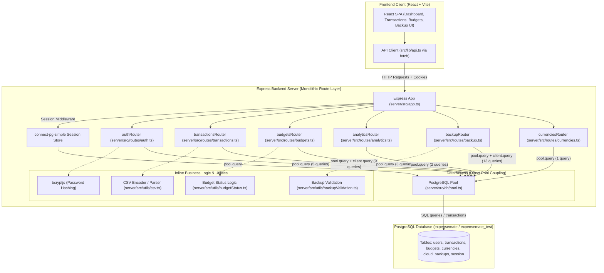

# Baseline Architecture ("Before" State)

This document describes the architectural state of ExpenseMate at the end of Assignment 01 (`assignment-01-baseline`).

---

## 1. Architectural Overview

The current backend is structured as a two-tier **"Route-to-Database" Monolith** (the Smart UI / Transaction Script anti-pattern).

The architecture lacks intermediate abstractions such as a **Service Layer** or a **Data Access Layer (Repository)**:
1. **HTTP Transport Layer**: Express route handlers receive incoming HTTP requests directly from the client.
2. **Embedded Business Logic**: Route handlers perform input validation, string manipulation, date parsing, password hashing, and business calculations directly inline.
3. **Direct SQL Coupling**: Route handlers import `{ pool } from "../db/pool.js"` and execute raw PostgreSQL queries directly via `pool.query()` or `client.query()`.
4. **Database Tier**: Relational PostgreSQL database storing users, transactions, budgets, currencies, cloud backups, and sessions.

---

## 2. Architecture Diagram (Mermaid)

---

## 3. Structural Deficiencies of the "Before" Architecture

1. **Tight Coupling to PostgreSQL (`pg.Pool`)**:
   - 33 separate `pool.query()` or `client.query()` calls across all 6 route files.
   - Any database schema migration or change requires editing route controller code.
   - Handlers cannot be tested with mock data stores without booting a live PostgreSQL database.

2. **Absence of a Service Layer**:
   - Domain rules (currency conversions, transaction aggregation, snapshot serialization) live in HTTP handler callbacks.
   - Code cannot be reused across different delivery mechanisms (e.g., CLI, background jobs, or alternative APIs).

3. **Absence of a Repository Layer**:
   - Queries are duplicated across routes (e.g. `INSERT INTO transactions` appears in `transactions.ts` and `backup.ts`; `INSERT INTO budgets ... ON CONFLICT` appears in `budgets.ts` and `backup.ts`).
   - Transaction boundary management (`BEGIN`, `COMMIT`, `ROLLBACK`) is manually coded inside route handlers.

4. **High Cyclomatic Complexity**:
   - Monolithic route handlers juggle validation, authentication checks, SQL execution, error branching, and response formatting in single functions, driving cyclomatic complexity up to 11.
